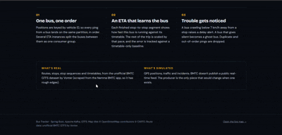
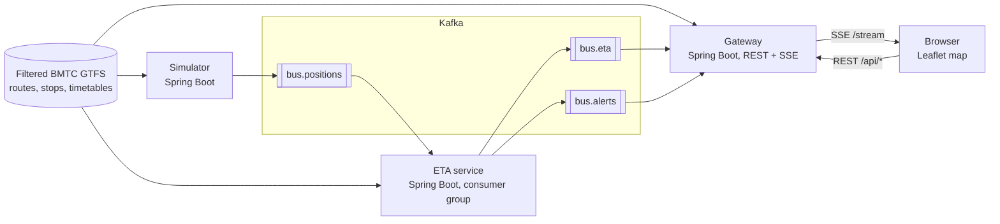

# Bus Tracker · ಬಸ್ ಎಲ್ಲಿದೆ?

Live bus tracking and ETAs for Bengaluru, streamed through Apache Kafka.

Bengaluru's buses rarely run to the timetable. This project replays buses over **real BMTC routes, stops and timetables**, streams their positions through Kafka, learns how late each bus really is, and shows honest ETAs on a live map.



> **What's real and what's simulated.** Routes, stops, stop sequences and timetables come from the unofficial BMTC GTFS dataset. **Bus positions are simulated**, because BMTC doesn't publish a public real-time feed. The events are shaped after GTFS-Realtime `VehiclePosition`, so a real feed would replace only the simulator.

## Features

- **Live map** with route filters (tick any combination of the four demo routes), moving buses, delay and ghost-bus highlighting, and a per-bus card with the next stops (timetable vs live ETA).
- **Stop search and arrivals board**: pick a stop, or click one on the map, to see which buses are coming, soonest first.
- **Direct-route finder**: from stop A to stop B on a single bus (no transfers), with the live buses that will make the trip.
- **Alerts**: delays, road blocks and buses that stop reporting.
- **Landing page** with live counters, driven by the same stream.

## Architecture



| Module | Responsibility |
|---|---|
| `common` | Event records, topic names, GTFS model and loader (shared by all services) |
| `simulator` | Drives buses along real route shapes and publishes their positions |
| `eta-service` | Consumes positions, computes ETAs, detects delays and ghost buses |
| `gateway` | Consumes ETAs and alerts, streams them to browsers (SSE), serves stop search, arrivals and route-finder APIs and the web UI |

## Kafka design

| Topic | Partitions | Key | Producer | Consumers |
|---|---|---|---|---|
| `bus.positions` | 6 | `vehicleId` | simulator | ETA service (one consumer group, concurrency 3) |
| `bus.eta` | 6 | `vehicleId` | ETA service | gateway |
| `bus.alerts` | 3 | `vehicleId` | ETA service | gateway |

- **Keyed by vehicle ID**, so every ping from one bus goes to the same partition and is processed in order. Per-bus state in the ETA service needs no locking.
- **Consumer group for the ETA service**: run a second instance and Kafka rebalances the partitions between the two.
- **Gateway uses a fresh consumer group on every start**, so each gateway instance sees every event (it is fanning out to browsers, not sharing work).
- **Duplicates and out-of-order pings** are dropped using event timestamps.
- The producer is idempotent (the Kafka client default).

## The simulator

Buses are driven by simple physics, not by the timetable:

- cruising speed about 19 km/h (5.4 m/s) with a per-bus spread, acceleration 0.9 m/s², braking 1.3 m/s²
- 20-45 s dwell at every stop, and traffic signals (fixed per route direction, red about 45% of the time, 15-40 s waits)
- slowly drifting traffic conditions
- three injected incident types: a **slowdown zone** (route 171), a **road block** (route K-2) and a **breakdown** (one bus goes silent)
- time runs at **10x** so the map is lively; positions are emitted every 10 simulated seconds

The timetable is only used as the baseline the ETA model is compared against.

## The ETA model

1. **Baseline:** a position-aware timetable. Wherever the bus is now, assume it follows the schedule from there.
2. **Pace:** every time a bus completes a stop-to-stop segment, compare the actual duration with the timetable duration and update a smoothed ratio (exponential moving average, alpha 0.4). If the current segment is already running longer than the pace predicts, the pace is reduced straight away.
3. **Corrected ETA** = timetable time remaining / pace.

**Scoring:** the first prediction made for each of the next 5 stops is compared with the simulated arrival time (mean absolute error, in simulated seconds).

### Results

Two 10-minute runs, 20 simulated buses on 4 real routes:

| Run | Predictions scored | Timetable MAE | Corrected MAE | Improvement |
|---|---|---|---|---|
| No incidents | 683 | 93.2 s | 75.5 s | **~19%** |
| With incidents | 836 | 211.7 s | 195.8 s | **~7.5%** |

Why the gain shrinks with incidents: the model has no warning when an incident starts. Its pace only reacts after a bus has already lost time, and the injected incidents are long, so incident delay dominates the error for both methods.

These numbers come from a simulator. They show the pipeline and model working, **not** how accurate the system would be on real BMTC buses.

## Alerts

| Alert | Trigger |
|---|---|
| `DELAY` | A bus moves slower than 7 km/h for 8 consecutive pings (80 simulated seconds) while not halted at a stop |
| `DELAY_CLEARED` | The bus moves at 11 km/h or more for 3 consecutive pings |
| `GHOST_BUS` | No ping from a bus for 90 simulated seconds of stream time |
| `GHOST_RECOVERED` | A ghost bus reports again |

## Run it locally

**Requirements:** JDK 21, Maven 3.9+, and Apache Kafka 3.9 (KRaft mode, single broker).

```bash
# 1. start a Kafka broker (see the Kafka quickstart for KRaft: format storage once, then start)
#    create the topics:
kafka-topics --create --topic bus.positions --partitions 6 --bootstrap-server localhost:9092
kafka-topics --create --topic bus.eta       --partitions 6 --bootstrap-server localhost:9092
kafka-topics --create --topic bus.alerts    --partitions 3 --bootstrap-server localhost:9092

# 2. build everything
mvn clean package

# 3. start the services, each in its own terminal, in this order (run from the repo root)
java -jar eta-service/target/eta-service-0.1.0.jar
java -jar gateway/target/gateway-0.1.0.jar
java -jar simulator/target/simulator-0.1.0.jar
```

Open **http://localhost:8081** (landing page) or **http://localhost:8081/app.html** (live map).

Useful flags:

```bash
# run the simulator without incidents
java -jar simulator/target/simulator-0.1.0.jar --bustracker.sim.incidents-enabled=false

# a second ETA instance, to watch the consumer group rebalance
java -jar eta-service/target/eta-service-0.1.0.jar --server.port=8082
```

**Notes**

- Run all services from the repo root; the data path (`data/filtered`) is relative.
- Restart the simulator and the ETA service together. Event timestamps restart with the simulator, and the ETA service ignores events that look older than ones it has already seen.
- On Windows, Kafka can crash when its log cleanup tries to rename files that Windows has locked. Setting `log.retention.hours=87600` and `log.retention.check.interval.ms=2147483647` in `server.properties` avoids this for local development.

## HTTP API (gateway)

| Endpoint | Description |
|---|---|
| `GET /stream` | Server-sent events: `eta`, `alert` and `reset` |
| `GET /api/routes` | Route shapes and stops |
| `GET /api/stops?q=` | Stop name search |
| `GET /api/arrivals?ids=` | Next buses reaching the given stop ids |
| `GET /api/plan?from=&to=` | Direct rides between two stops, with live buses |
| `GET /api/stats` | Live counters and a mini arrivals board |

## Data

Routes, stops and timetables are from the unofficial BMTC GTFS dataset by Vonter: <https://github.com/Vonter/bmtc-gtfs>. It was scraped from the Namma BMTC app, so it has gaps (missing routes, rough shapes, approximate timetables). The repo contains a small filtered subset (4 routes) produced by `scripts/filter_gtfs.py`. Please check the source repository's terms before reusing the data.

## Limitations

- **Positions are simulated.** The ETA model has not been tested on real bus GPS data.
- The baseline is a simple timetable baseline, and the pace model is a smoothed ratio, not a trained model. It does not use time-of-day patterns or per-segment speeds.
- Per-bus state is in memory, so an ETA service restart resets the pace estimates.
- Four routes only. The route finder handles direct rides only (no transfers).
- No automated tests yet.

## Roadmap

- Retry topic and dead-letter queue for bad events
- More routes, and a transfer-aware journey planner
- Per-segment and time-of-day speed model
- Feed incident state into the ETA estimate
- Persist alert history and accuracy snapshots
- Docker Compose for one-command startup, and deployment

## Project structure

```
bus-tracker/
├── common/        shared events, topic names, GTFS model and loader
├── simulator/     bus physics, incidents, Kafka producer
├── eta-service/   ETA model, delay and ghost detection, accuracy tracking
├── gateway/       Kafka consumers, SSE, REST APIs, web UI (static/)
├── data/filtered/ filtered GTFS for the 4 demo routes
└── scripts/       filter_gtfs.py
```

## Tech

Java 21 · Spring Boot 3 · Spring for Apache Kafka · Apache Kafka (KRaft) · GTFS · Server-Sent Events · Leaflet · Maven multi-module